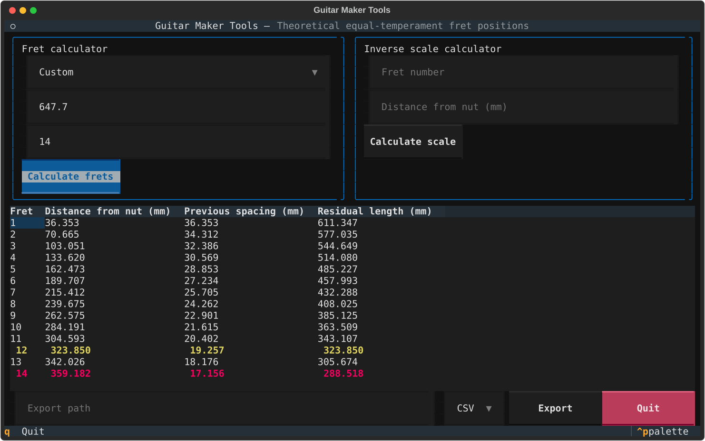
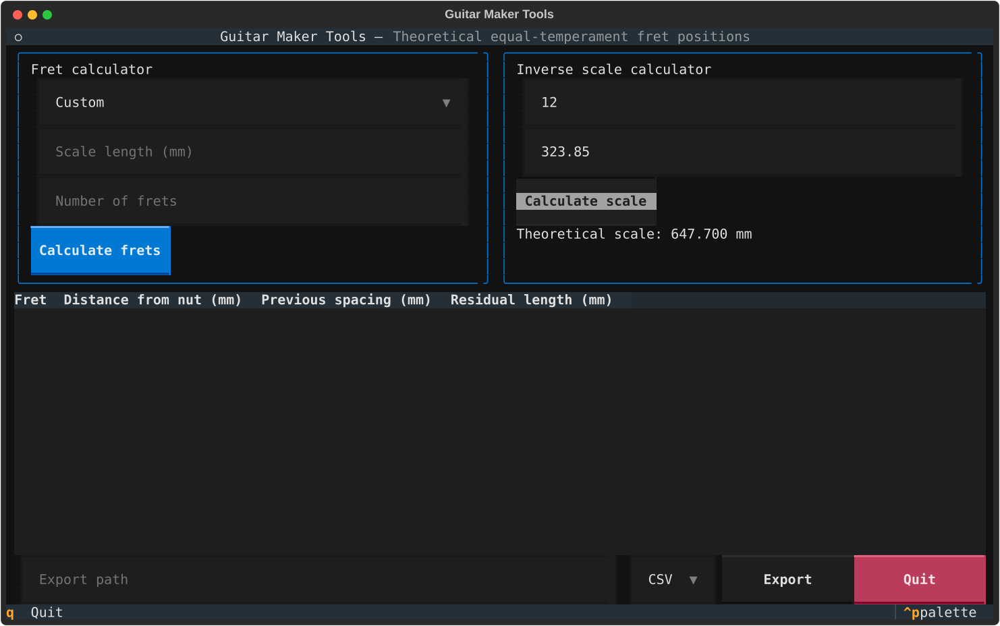

# Guitar Maker Tools

Terminal application for preliminary guitar-design calculations.

**Current version:** 1.0.0

## Version 1

The first tool calculates equal-temperament fret positions from a nominal scale
length, in millimetres. It also supports inverse scale calculation, common-scale
presets, and CSV or text exports.

All fret positions are theoretical measurements from the nut edge facing the
bridge. Bridge intonation compensation is intentionally not included.

## Requirements

- Python 3.11 or newer
- Conda environment `guitar_tools`

## Installation

Activate the existing development environment, then install the application
with its development dependencies:

```bash
conda activate guitar_tools
python -m pip install -e ".[dev]"
```

## Starting the application

Run the Textual terminal interface:

```bash
guitar-maker-tools
```

If the console command is not available, start it as a Python module:

```bash
python -m guitar_maker_tools
```

Select **Quit**, press `Q`, or use `Ctrl+C` to close the application.

## Screenshots

### Fret calculation

The fret calculator displays theoretical positions, inter-fret spacing, and
residual string length for the selected scale.



### Inverse scale calculation

The inverse calculator derives a nominal scale from a known fret position.



## Using the application

### Calculate fret positions

1. Optionally select a scale from the preset menu. Selecting a preset fills
   the **Scale length (mm)** field; it can still be edited.
2. Enter the nominal scale length in millimetres.
3. Enter a positive whole number in **Number of frets**.
4. Select **Calculate frets**.

The results table provides, for every fret:

- **Distance from nut (mm)**: absolute position from the nut edge facing the
  bridge;
- **Previous spacing (mm)**: distance from the preceding fret;
- **Residual length (mm)**: theoretical vibrating-string length after fretting.

Values shown in the table are rounded to three decimal places. Each value is
calculated from the common nut reference, not by adding displayed spacings.
The 12th-fret row is highlighted in yellow and the 14th-fret row in magenta
for faster visual reference.

### Numerical precision

The calculation engine retains `Decimal` values in a 36-significant-digit
calculation context. Equal temperament requires fractional powers such as
`2^(n/12)`; except where the result is exactly representable, these values are
rounded within that finite calculation context. The three decimal places shown
in the application and exports are a separate presentation rounding, not a
claim of absolute mathematical precision or a construction tolerance.

The preset menu includes common Fender, Gibson, Martin, Taylor, classical, and
short-scale dimensions. Martin presets include 25.4 in and 24.9 in; Taylor
presets include the standard 25.5 in scale and the GS Mini 23.5 in scale.

### Calculate a scale from an existing fret

1. In **Inverse scale calculator**, enter a positive whole **Fret number**.
2. Enter its measured **Distance from nut (mm)**.
3. Select **Calculate scale**.

The application displays the corresponding theoretical nominal scale.

### Export a fret table

First calculate fret positions. Then enter a target file path in
**Export path**, choose a format from the **CSV/Text** selector, and select
**Export**:

- **CSV** produces column-based data with values rounded to three decimal
  places;
- **Text** produces a three-decimal, fixed-width table suitable for reading or
  printing.

The destination directory must already exist. Exports are written atomically,
so a failed write does not replace an existing destination file.

## Measurement convention

All V1 inputs and results use millimetres. Fret positions are theoretical
equal-temperament dimensions measured from the nut edge facing the bridge.
Bridge intonation compensation is intentionally outside this version.

## Development

```bash
conda activate guitar_tools
pytest
```

The mathematical basis and measurement convention are documented in
[`docs/rapporto_scala_posizione_tasti.md`](docs/rapporto_scala_posizione_tasti.md).

## Project resources

- [Project specification](docs/progetto_v1.md)
- [Work progress](docs/avanzamento_lavori.md)
- [Changelog](CHANGELOG.md)
